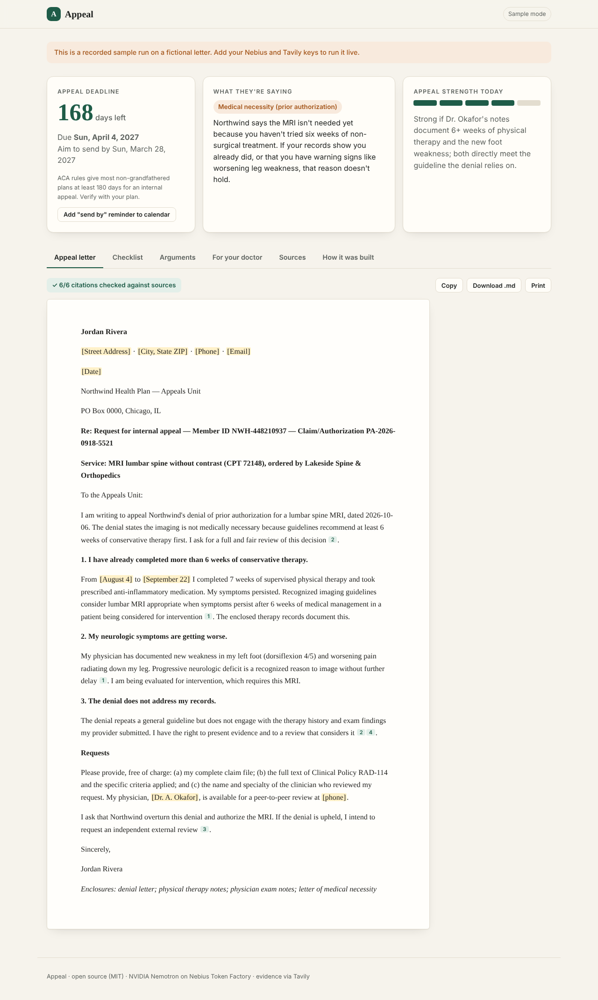

# Appeal — fight your health-insurance denial

**Your insurer said no. Appeal writes the letter that gets a yes.**

Upload a photo or PDF of a denial letter. Appeal reads it, finds the insurer's own policy, the clinical evidence and the appeal rules that apply, builds the strongest honest argument, and drafts a ready-to-send appeal letter. Every claim in the letter is cited and checked. You also get your deadline (with a calendar reminder), an evidence checklist and a letter-of-medical-necessity template to give your doctor.

> Track: **Best Apps and Agents** · Nebius x NVIDIA Global AI Hackathon
> Built with **NVIDIA Nemotron** on **Nebius Token Factory**, with evidence from **Tavily**.



## Why this matters

Insurers deny claims every day, and most denied patients never appeal, even though appeals are often successful. Patients don't skip appeals because their case is weak. They skip them because the process is opaque: dense letters, unfamiliar policy language, hidden deadlines and no idea what evidence matters. Appeal turns a confusing letter into a clear plan and a professional letter in about a minute.

## How it works: right-sized Nemotron models for each step

| Step | What happens | Model (Nebius Token Factory) |
|---|---|---|
| 1. Read | Reads a scanned or photographed letter and extracts insurer, codes, the quoted reason, the policy cited and dates as structured JSON | **Nemotron 3.5 Super VL** (vision) |
| 2. Triage | Classifies the denial (medical necessity, prior auth, out-of-network…), explains it in plain English, plans research | **Nemotron 3.5 Lightning** (fast, cheap) |
| 3. Research | Parallel searches for the insurer's coverage policy, clinical guidelines (restricted to authoritative domains) and federal/state appeal rules | **Tavily Search API** |
| 4. Strategy | The hard reasoning: does the patient meet the insurer's own criteria? where is the denial procedurally weak? what evidence is missing? Arguments may only cite retrieved sources | **Nemotron 3 Ultra** |
| 5. Draft | Formal appeal letter plus a doctor's letter-of-medical-necessity template. Unknown facts become `[PLACEHOLDERS]`, never invented | **Nemotron 3 Super** |
| 6. Verify | Checks every `[n]` citation in the letter against its source and flags unsupported claims | **Nemotron 3 Super** |

Design choices that matter:

- **Ultra runs once, where it counts.** Reading, triage and JSON repair go to the smallest model that does the job well. The "How it was built" tab shows a per-step ledger of model, tokens and latency.
- **Grounded by construction.** The strategy step sees only numbered Tavily sources. Citations to source ids that don't exist are removed in code, and a separate model verifies the rest.
- **Deadline safety.** The deadline printed on the letter always wins. Otherwise Appeal uses a conservative, labelled default for the plan type and suggests sending a week early. It also produces an `.ics` reminder.
- **Private by default.** Uploads stay in memory for a single request. Nothing is written to disk or logged.
- **Streams live.** Each step streams to the UI as server-sent events, so users watch the agent work instead of staring at a spinner.

## Run it

```bash
git clone <this repo> && cd appeal
python -m venv .venv && source .venv/bin/activate
pip install -r requirements.txt
cp .env.example .env            # add NEBIUS_API_KEY and TAVILY_API_KEY
export $(grep -v '^#' .env | xargs)
python -m app.check_models      # confirms the Nemotron model ids on your account
uvicorn app.main:app --reload   # open http://localhost:8000
```

Click **Try a sample letter** to run the fictional sample in `samples/sample_denial.png`.

Without keys, the app starts in **sample mode** and replays a recorded run so the interface can still be explored. The UI clearly labels it as a sample. Set `DEMO_MODE=off` to force live mode.

### Docker / Nebius deployment

```bash
docker build -t appeal . && docker run -p 8000:8000 --env-file .env appeal
```

See [docs/DEPLOY.md](docs/DEPLOY.md) for deploying to Nebius AI Cloud.

### Tests

```bash
pip install pytest && pytest -q
```

The tests cover deadline logic, robust JSON parsing of reasoning-model output, the demo replay and the full live pipeline with network calls mocked. They check model routing and that citations to sources that don't exist are filtered out.

## Project layout

```
app/
  main.py        FastAPI server, SSE streaming, .ics endpoint
  pipeline.py    the 6-step agent
  llm.py         Token Factory client, JSON repair, per-model ledger
  research.py    Tavily evidence gathering + source numbering
  prompts.py     all prompts
  deadlines.py   deadline rules + calendar export
  demo_data.py   recorded sample run (fictional)
static/          the web app (no build step)
samples/         fictional denial letter for demos
tests/
```

## Built with

- **NVIDIA Nemotron** (3.5 Super VL, 3.5 Lightning, 3 Super, 3 Ultra) via **Nebius Token Factory** (OpenAI-compatible API)
- **Tavily** Search API for live, citable evidence
- FastAPI, PyMuPDF, vanilla JS/CSS

## Disclaimer

Appeal is not a lawyer or a doctor and does not give legal or medical advice. It helps people write their own appeals. Review every letter before sending. The sample insurer, member and IDs are fictional.

## License

MIT. See [LICENSE](LICENSE).
